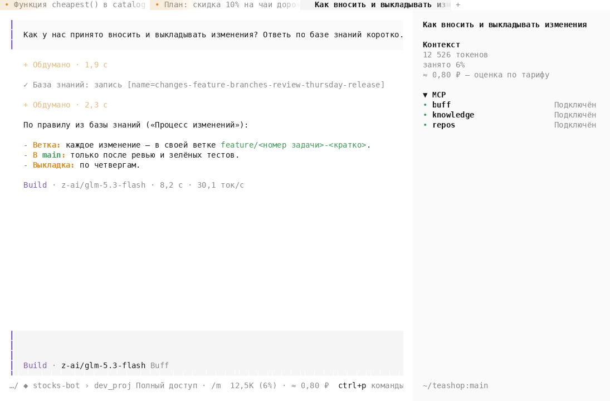
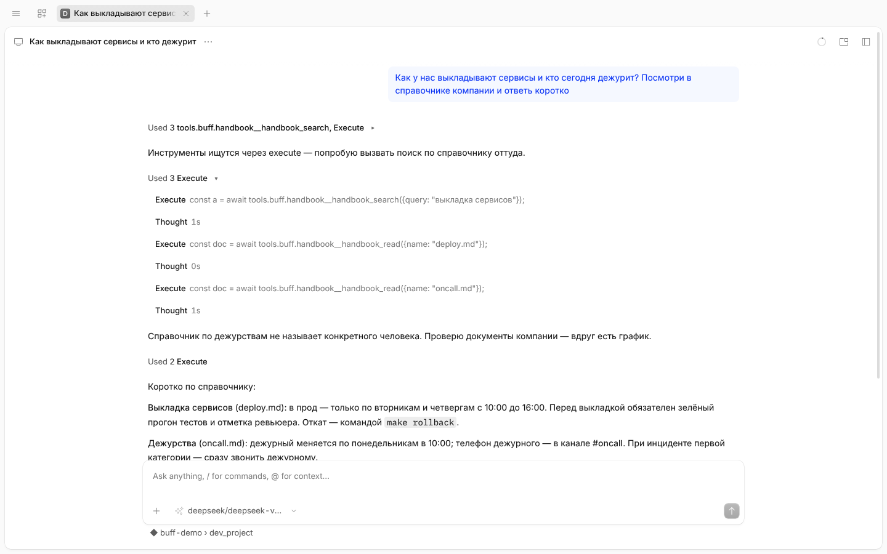

<p align="center">
  <picture>
    <source media="(prefers-color-scheme: dark)" srcset="buff/assets/logo-dark.svg">
    
  </picture>
</p>

<p align="center">
  <b>Buff Code — среда разработки для инженеров, которые пишут код сами.</b><br>
  Консоль и приложение на моделях, знаниях и подключениях вашей организации — или на вашей собственной модели.
</p>

<p align="center">
  <a href="https://github.com/buffsystems/buff-code/releases"></a>
  <a href="LICENSE"></a>
  <a href="https://buff.systems/docs/buff-code"></a>
</p>

<p align="center">
  <a href="#установка">Установка</a> ·
  <a href="#что-умеет">Что умеет</a> ·
  <a href="#как-это-работает">Как это работает</a> ·
  <a href="#сборка-из-исходников">Сборка</a> ·
  <a href="https://buff.systems/docs/buff-code">Документация</a> ·
  <a href="README.en.md">English</a>
</p>

---

**Buff Code** — агент в вашей папке проекта: консоль `buff` и приложение для Linux, macOS и Windows. Это второй способ работать с [Buff](https://buff.systems): в веб-приложении задачу ведёт платформа — сама пишет код, проверяет и приносит на приёмку; в Buff Code код пишет инженер, а модель помогает ему в его папке и терминале — с тем же знанием о компании.

К моделям Buff Code подключается через коннектор компании, через LiteLLM или напрямую — подходит любой OpenAI-совместимый эндпоинт. Через коннектор он получает и остальное, что есть у организации: знания, репозитории, подключения и запись каждого хода в кабинете.

<p align="center">
  
  
</p>

## Установка

Консоль — одной командой:

```sh
curl -fsSL https://buff.systems/install | bash
```

Приложение для Linux, macOS и Windows, контрольные суммы и подписи cosign каждого выпуска — в [выпусках](https://github.com/buffsystems/buff-code/releases) и на [buff.systems/downloads](https://buff.systems/downloads). При первом запуске Buff Code спросит адрес коннектора вашей компании и код из кабинета — или предложит подключить свою модель. Подробно — [Установка](https://buff.systems/docs/buff-code/install) и [Вход](https://buff.systems/docs/buff-code/sign-in).

## Что умеет

| | |
|---|---|
| **Знания компании под рукой** | Модель читает базу знаний организации и предлагает в неё записи, ищет по репозиториям проекта без клона на машине и вызывает инструменты подключений коннектора — трекеры, wiki, ваши серверы MCP. |
| **Видно и обратимо** | Под каждым ответом — что агент изменил; дифф, безопасный откат с проверкой чужих правок. Запросы разрешений с предпросмотром правки. |
| **Большие задачи — по плану** | План с утверждением, список дел агента и цель `/goal`: агент делает ходы, пока проверка не подтвердит результат. Сценарии — субагенты по фазам с проверками. |
| **По расписанию** | Автоматизации: задачи агенту по расписанию, их запускает служба на машине — и при закрытом окне. |
| **Git в окне** | Что изменено, коммит с сообщением от агента, отправка, ветки и история. |
| **Расширяется** | Свои серверы MCP, навыки, команды, субагенты, память `AGENTS.md` и хуки — из настроек окна и консоли. |
| **Любые модели** | Модели организации через коннектор, шлюз LiteLLM или провайдер напрямую — OpenRouter, Anthropic, OpenAI, Ollama, LM Studio и любой OpenAI-совместимый эндпоинт; можно сочетать. |
| **Каждый ход записан** | Сессии разработки видны в кабинете: разработчику — свои, владельцу — все; по записям можно задавать вопросы. |

## Как это работает

Три пути к моделям — их можно сочетать:

```
                ┌─▶ коннектор компании ──▶ Buff  (модели организации, знания, записи)
Buff Code ──────┼─▶ LiteLLM               (OpenAI-совместимый шлюз к моделям)
(машина         └─▶ провайдер напрямую    (OpenRouter, Anthropic, OpenAI, Ollama, LM Studio…)
 разработчика)
```

- **Через [коннектор](https://github.com/buffsystems/buff-connector) компании** (шлюз разработчика) — модели, которые выбрал администратор, база знаний, репозитории проекта и инструменты подключений, запись каждого хода в кабинете. Ключей провайдеров на машине разработчика нет; вход — по коду из кабинета.
- **Через LiteLLM** — шлюз к моделям по OpenAI-совместимому API: ключ шлюза вместо ключей провайдеров.
- **Напрямую** — к любому OpenAI-совместимому эндпоинту: облачный провайдер со своим ключом или локальная модель.

Buff Code — форк [opencode](https://github.com/anomalyco/opencode) (MIT): ядро держим близко к апстриму, своё строим на его точках расширения.

## Сборка из исходников

Нужен [Bun](https://bun.sh) 1.4.

```sh
bun install
bun dev ~/my-project  # консоль из исходников на каталоге проекта
```

`buff/Makefile` собирает артефакты выпуска (`make -C buff dist`, `make -C buff desktop`) в контейнере — инструменты одинаковы везде.

## Участие и лицензия

Ошибки и предложения — через [issues](https://github.com/buffsystems/buff-code/issues), правки — pull request'ом; правила — в [CONTRIBUTING.md](CONTRIBUTING.md) (включая работу с ИИ-помощниками). Репозиторий публикуется снимком на каждый выпуск Buff: принятые изменения выходят в следующем.

Лицензия — [MIT](LICENSE): © opencode, © Buff Systems. Дизайн-система — [buff-ui](https://github.com/buffsystems/buff-ui).
